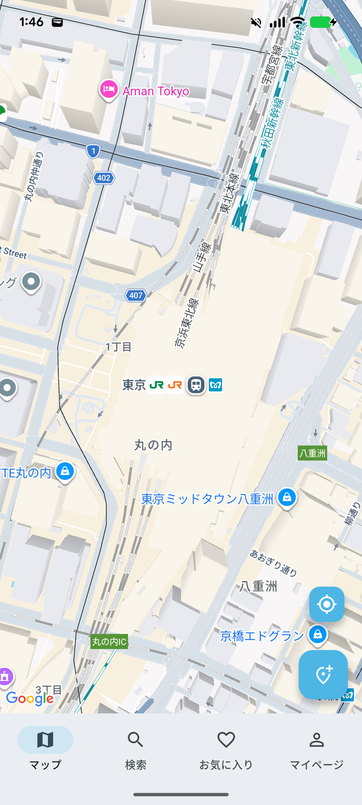

# 自販機ナビ（Vending Navi）

## スクリーンショット

---

## 概要

「今飲みたいドリンクを買える自販機を探す」ことを目的としたモバイルアプリです。

ドリンク名（例：綾鷹、BOSSなど）から検索し、近くで購入できる自販機をマップ上で確認できます。

---

## 主な機能

- マップ上で近くの自販機を表示
- ドリンク名で自販機を検索
- 自販機の登録・編集
- ドリンク情報の登録・更新
- お気に入り機能

---

## 使用技術

- Flutter（Dart）
- Firebase
  - Firestore（データ管理）
  - Authentication（認証）
- Google Maps API

---

## 背景

外出先で「この飲み物が飲みたい」と思っても、どの自販機にあるかわからないという課題を感じたため開発しました。

---

## アーキテクチャ

Flutter（フロントエンド）からFirebaseに直接アクセスする構成で、シンプルかつ高速な開発を意識しています。

---

## プライバシー文書

このREADMEはプライバシーポリシーではありません。取得する情報、利用目的、外部サービスによる情報の処理、保存期間については、[プライバシーポリシー](https://vendingnavi.web.app/privacy)をご確認ください。

---

## 注意事項

- 自販機の情報はユーザー投稿に基づきます
- 実際の販売内容と異なる場合があります
- 私有地や立ち入り禁止エリアには入らないようにしてください

---

## アカウント削除方法

アプリにログインし、**マイページ → アカウント削除**から手続きできます。本人確認のため、再認証を求める場合があります。

削除されるデータと、公開情報・バックアップ・監査記録など保持される場合がある情報の詳細は、[アカウント削除ページ](https://vendingnavi.web.app/delete-account)と[プライバシーポリシー](https://vendingnavi.web.app/privacy)をご確認ください。

## 開発状況

初回リリース版（v1.0.0）

---

## 作者

mekido